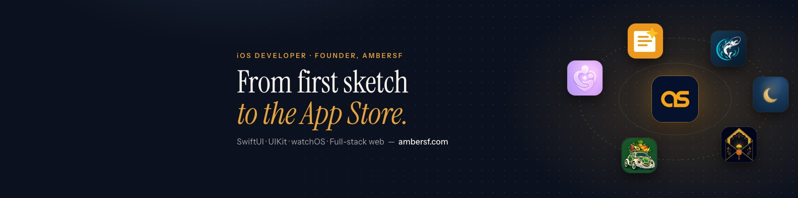

## Hi, I'm Amber 👋

iOS developer with 5+ years of production experience (Getcontact, METRO Turkey, Nefis Yemek Tarifleri) and the founder of **[AmberSF](https://www.ambersf.com/en/)**, an independent studio where I design, build and ship my own apps end to end on iOS and Android.

Most of that work lives in private repositories, so here is what it adds up to.

### Apps

| | App | What it does | Platforms |
|---|---|---|---|
| 💜 | **[ParentAI](https://www.ambersf.com/parentai/en/)** | AI parenting coach for kids 0–16: daily tips, chat coach, stories, home activities | [App Store](https://apps.apple.com/app/id6761167222) · [Google Play](https://play.google.com/store/apps/details?id=com.parentai.android) |
| 🌙 | **[Vaktinde](https://www.ambersf.com/vaktinde/en/)** | Prayer times, Qibla compass and adhan alerts, with widgets, Live Activities and Apple Watch | [App Store](https://apps.apple.com/app/id6786821492) · [Google Play](https://play.google.com/store/apps/details?id=com.ambersf.vaktinde) |
| 📝 | **[Notivera](https://www.ambersf.com/notivera/en/)** | AI note-taking: voice, photos and documents become organized notes | [App Store](https://apps.apple.com/app/id6757314647) |
| 🎣 | **[ExpertCast](https://www.ambersf.com/expertcast/en/)** | Fishing companion: catch log, species guide, spots map, weather | iOS |
| 💌 | **[e-Davetiye](https://www.ambersf.com/e-davetiye/en/)** | Digital invitations guests open in the browser, no install needed | iOS · Android |
| 🐟 | **[Balık Cetveli](https://www.ambersf.com/balik-cetveli/en/)** | Is this fish legal to buy or catch right now? Turkey's fishing rules, offline | iOS, coming soon |

### Ventures

🥑 **[Vosvos Tropikal](https://vosvostropikal.com)**: the tropical fruit store I co-founded and built end to end. Next.js, TypeScript and Supabase, with 3D Secure payments, a courier and depot screen, shipping labels and cost-based pricing.

### Open source

- **[Lantern](https://github.com/ambercatalbas/Lantern)**: in-app observability for iOS. Pluggable network, console and analytics probes feed a shake-to-open SwiftUI inspector.
- **[e-davetiye](https://github.com/ambercatalbas/e-davetiye)**: the browser engine that renders e-Davetiye invitations.

### Stack

**iOS:** Swift, SwiftUI, UIKit, Swift Concurrency, WidgetKit, ActivityKit, App Intents, StoreKit 2, watchOS\
**Android:** Kotlin, Jetpack Compose, Google Play Billing\
**Backend & web:** Firebase, Supabase, Node.js, Next.js, PostgreSQL\
**Workflow:** MVVM, Clean Architecture, XCTest, Fastlane, AI-assisted development with Claude Code

### Contact

🌐 [ambersf.com](https://www.ambersf.com/en/) · 💼 [LinkedIn](https://www.linkedin.com/in/amber-%C3%A7atalba%C5%9F-924bab206/) · ✉️ support@ambersf.com
